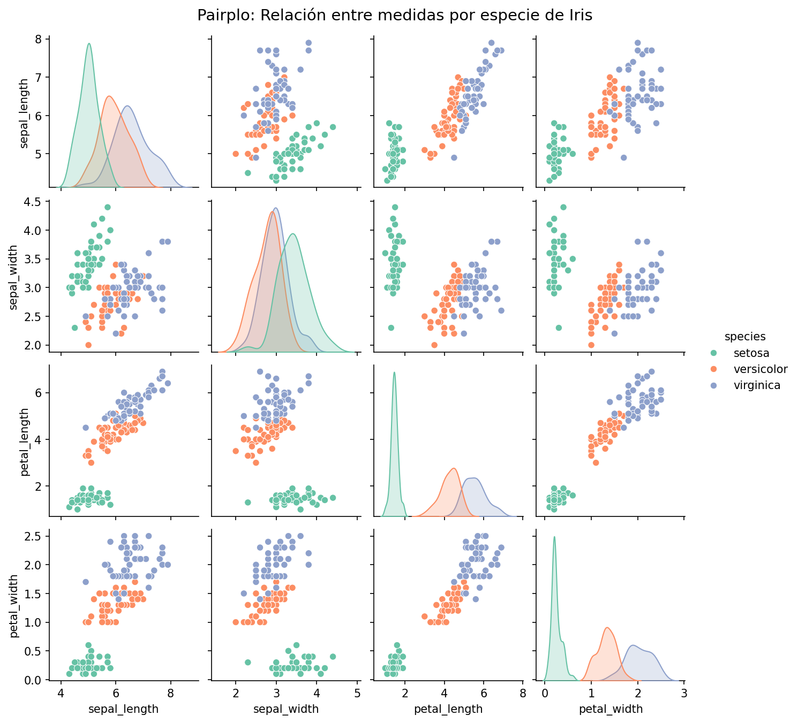
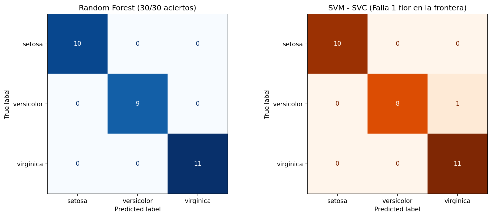
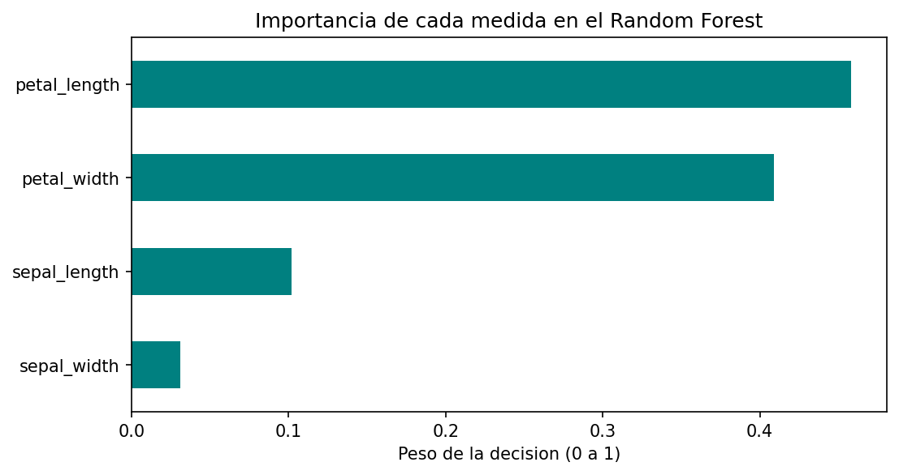

# Clasificación de Flores Iris · Machine Learning

Proyecto de clasificación multiclase donde predecimos la especie de una flor a partir de sus medidas anatómicas, comparando 4 algoritmos de Machine Learning (**Regresión Logística**, **Árbol de Decisión**, **Random Forest** y **SVM**) y optimizando sus hiperparámetros con validación cruzada.

---

## 1. El problema y los datos

A partir del dataset clásico de **Iris** (150 flores en total, 50 de cada especie), queremos predecir la **especie** (`setosa`, `versicolor` o `virginica`) basándonos en 4 medidas numéricas continuas (en cm):

* `sepal_length`: Longitud del sépalo
* `sepal_width`: Ancho del sépalo
* `petal_length`: Longitud del pétalo
* `petal_width`: Ancho del pétalo

---

## 2. Análisis Exploratorio de Datos (EDA Visual)

Antes de entrenar los algoritmos, cruzamos todas las medidas por parejas (**Pairplot**) coloreadas según la especie para entender cómo se distribuyen las flores:



### Hallazgos del Pairplot:
* **Aislamiento total de *Setosa*:** En todas las gráficas donde intervienen el largo o ancho del pétalo (`petal_length` y `petal_width`), *Setosa* queda completamente separada del resto. Cualquier modelo la clasifica con un 100% de precisión.
* **Frontera crítica (*Versicolor* vs. *Virginica*):** Estas dos especies se rozan ligeramente en los valores intermedios de pétalo. Esa zona de solapamiento es donde realmente compiten los modelos.
* **Pétalos vs. Sépalos:** Las curvas de la diagonal muestran que `sepal_width` mezcla las 3 especies, mientras que las medidas del pétalo las separan con gran claridad.

---

## 3. Metodología paso a paso

### 3.1. Separación de datos (`train_test_split`)
Para evaluar los modelos con honestidad y comprobar que aprenden a generalizar en vez de memorizar:
* **Train (80% - 120 flores):** Con lo que los algoritmos aprenden los patrones y realizan la validación cruzada.
* **Test (20% - 30 flores):** Flores reservadas bajo llave para el examen final.

### 3.2. Escalado de variables (`StandardScaler`)
Transformamos las columnas numéricas para que tengan **media 0 y desviación estándar 1**. Esto evita que variables con números más grandes dominen el cálculo de distancias o gradientes (imprescindible para Regresión Logística y SVM). Se ajusta (`fit_transform`) solo en *Train* para evitar fuga de datos (*Data Leakage*).

### 3.3. Modelos comparados y Búsqueda de Hiperparámetros (`RandomizedSearchCV`)
Usamos **`RandomizedSearchCV`** con validación cruzada de 5 particiones (`cv=5`) para encontrar automáticamente la mejor configuración de cada candidato:

1. **Regresión Logística (`best_log_reg`):** Calcula la probabilidad (de 0 a 1) de pertenecer a cada una de las 3 especies. Se optimiza el parámetro **`C`** (inverso de la fuerza de regularización) para controlar la complejidad.
2. **Árbol de Decisión (`best_tree`):** Clasifica mediante una cadena de preguntas por umbrales (`Sí / No`). Sirve como línea base (*baseline*); un solo árbol tiende a sobreajustarse (*overfitting*).
3. **Random Forest (`best_rf`):** Entrena un bosque de 200 árboles con muestras y medidas aleatorias que deciden la especie por mayoría de votos, corrigiendo los errores individuales de un árbol solitario.
4. **Support Vector Machine (`best_svm`):** Busca la frontera geométrica que separa las especies dejando la "carretera" (margen de seguridad) más ancha posible entre las flores límite (*vectores de soporte*).

---

## 4. Resultados y Evaluación Final

### 4.1. Tabla Comparativa de Métricas

| Modelo | CV Accuracy (Train) | Accuracy (Test) | F1-Score (Test) | Mejor Hiperparámetro |
|---|---|---|---|---|
| **Regresión Logística** | `95.83%` | `100.0%` | `1.0000` | `C=21.54` |
| **Árbol de Decisión** | `95.00%` | `100.0%` | `1.0000` | `max_depth=None, min_samples_split=2` |
| **Random Forest** | `95.83%` | `100.0%` | `1.0000` | `n_estimators=200, max_depth=20` |
| **SVM (SVC)** | `95.83%` | `96.67%` | `0.9659` | `C=10, kernel='linear'` |

* **En Validación Cruzada (120 flores de Train):** Regresión Logística, Random Forest y SVM empatan acertando 115 de 120 flores (`95.83%`), superando al Árbol de Decisión individual (`95.00%`, 114 de 120 flores).
* **En el conjunto de Test (30 flores nuevas):** Regresión Logística, Árbol de Decisión y Random Forest logran un pleno del **100% (`30/30`)**, mientras que SVM acierta **29 de 30 flores (`96.67%`)**.

---

### 4.2. Matriz de Confusión (Random Forest vs. SVM)



* Las **10 flores *Setosa*** del conjunto de prueba se clasifican sin ningún fallo en todos los modelos.
* El único error del **SVM** ocurre exactamente donde anticipó el EDA: una flor *Versicolor* situada en el borde de la frontera que el modelo clasificó como *Virginica*.

---

### 4.3. Importancia de cada medida en Random Forest (`feature_importances_`)



| Medida | Peso en la decisión |
|---|---|
| `petal_length` (Largo del pétalo) | **45.80%** |
| `petal_width` (Ancho del pétalo) | **40.88%** |
| `sepal_length` (Largo del sépalo) | **10.20%** |
| `sepal_width` (Ancho del sépalo) | **3.12%** |

Los 200 árboles del Random Forest confirman matemáticamente lo observado en el Pairplot: **las medidas del pétalo concentran el 86.68% del poder predictivo**, mientras que el sépalo apenas aporta un 13.32%.

---

## 5. Estructura del proyecto

```text
02-iris-clasificación/
├── data/
│   └── iris.csv                              # Dataset original (150 filas x 5 columnas)
├── notebooks/
│   └── 01-iris.ipynb                         # Flujo completo: EDA, modelado y evaluación
├── reports/
│   └── figures/                              # Gráficos exportados desde el notebook
│       ├── 01-pairplot_iris_png.png
│       ├── 02_confusion_matrix.png
│       └── 03_feature_imporances.png
└── README.md
```

---

## 6. Requisitos e Instalación

```bash
# 1. Activar entorno virtual (desde la raíz del repositorio)
.venv\Scripts\activate

# 2. Instalar librerías necesarias
pip install pandas numpy scikit-learn matplotlib seaborn jupyter

# 3. Iniciar el notebook
jupyter notebook notebooks/01-iris.ipynb
```

---

## ✅ Checklist del Plan de Mejora (Completado)

- [x] **Paso 1:** Análisis Exploratorio Visual (EDA - Pairplot) y exportación a `reports/figures/`.
- [x] **Paso 2:** Limpieza de warnings en Regresión Logística y extracción de `best_params_` y `best_score_`.
- [x] **Paso 3:** Incorporación de Árbol de Decisión individual (`DecisionTreeClassifier`) y Support Vector Machine (`SVC`).
- [x] **Paso 4:** Cálculo de `Accuracy` y `F1-Score` en Test y tabla comparativa de los 4 modelos.
- [x] **Paso 5:** Matrices de Confusión e Importancia de Variables (`feature_importances_`) del Random Forest.
- [x] **Paso 6:** Documentación de requisitos, estructura y hallazgos visuales en el `README.md`.
