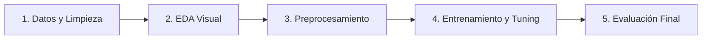

---
tags:
  - indice
  - moc
---

# 🧠 00 · Mapa Mental Central de IA y Data Science (MOC)

Bienvenido a tu **Segundo Cerebro de Inteligencia Artificial y Data Science**. Esta nota es el centro de tu grafo: desde aquí se conectan todos tus proyectos, algoritmos, conceptos matemáticos, métricas y librerías.

---

## 🗺️ 1. La Gran Brújula: ¿Cómo se organiza la IA?

Antes de escribir una sola línea de código en un proyecto, siempre respondemos a dos preguntas:

1. **¿Tengo las respuestas reales en mi tabla de datos?** $\rightarrow$ [[Aprendizaje Supervisado vs No Supervisado]]
   * **Sí tengo la columna respuesta (`y`)** $\rightarrow$ *Aprendizaje Supervisado* (Ej: sabemos la especie en [[02-Clasificación Iris]] o el salario en [[03-Regresión Lineal desde Cero]]).
   * **No tengo etiquetas (voy a ciegas)** $\rightarrow$ *Aprendizaje No Supervisado / Clustering* (Ej: agrupar puntos por cercanía con **K-Means**).
2. **¿Qué tipo de cosa quiero adivinar (`y`)?** $\rightarrow$ [[Clasificación vs Regresión]]
   * **Quiero adivinar una Categoría / Etiqueta** (*Setosa, Versicolor o Virginica*) $\rightarrow$ **Clasificación**.
   * **Quiero adivinar un Número Continuo** (*Salario en miles de € o Precio de vivienda*) $\rightarrow$ **Regresión**.

---

## 🔄 2. Las 5 Etapas de Cualquier Proyecto de Machine Learning

1. **Datos y Limpieza:** [[DataFrame, Limpieza y Deflactar]] · [[pandas]] · [[NumPy]]
2. **Exploración Visual (EDA):** [[EDA y Pairplot]] · [[matplotlib y seaborn]]
3. **Preparación para no hacer trampa:** [[Train-Test Split y Data Leakage]] · [[StandardScaler (Escalado)]]
4. **Entrenamiento (El Motor):**
   * *¿Cómo aprende por dentro?* $\rightarrow$ [[Descenso del Gradiente]] · [[Learning Rate y Épocas]]
   * *¿Cómo evitamos que memorice?* $\rightarrow$ [[Overfitting vs Underfitting]] · [[Regularización (Parámetro C y Penalty)]]
   * *¿Cómo elegimos la mejor configuración?* $\rightarrow$ [[RandomizedSearchCV y Validación Cruzada]]
5. **Examen Final (Métricas):**
   * *Si es Clasificación:* [[Accuracy]] · [[F1-Score (Precisión y Recall)]] · [[Matriz de Confusión]] · [[Feature Importances]]
   * *Si es Regresión:* [[MSE (Error Cuadrático Medio)]] · [[R2 (Coeficiente de Determinación)]]

---

## 🚀 3. Mis Proyectos del Portfolio

| # | Proyecto | Tipo de Problema | Conceptos Estrella Aprendidos |
|---|---|---|---|
| **01** | [[01-EDA Vivienda España]] | Análisis Exploratorio (EDA) | [[DataFrame, Limpieza y Deflactar]], `groupby()`, `merge()`, IPC y esfuerzo hipotecario. |
| **02** | [[02-Clasificación Iris]] | Clasificación Multiclase (Supervisado) | [[EDA y Pairplot]], [[StandardScaler (Escalado)]], competición entre [[Regresión Logística]], [[Árbol de Decisión]], [[Random Forest]] y [[SVM (Support Vector Machine)]]. |
| **03** | [[03-Regresión Lineal desde Cero]] | Regresión Lineal *Under the Hood* (Supervisado) | Programar [[Regresión Lineal]], [[MSE (Error Cuadrático Medio)]], [[Descenso del Gradiente]], [[R2 (Coeficiente de Determinación)]] y [[Programación Orientada a Objetos en ML (fit y predict)]] 100% con [[NumPy]]. |

---

## 🤖 4. Catálogo de Algoritmos

* **Para predecir números (Regresión):**
  * [[Regresión Lineal]] ($\hat{y} = w \cdot x + b$)
* **Para predecir categorías (Clasificación):**
  * [[Regresión Logística]] *(Fórmula matemática de probabilidades de 0 a 1)*
  * [[Árbol de Decisión]] *(1 árbol haciendo preguntas de `Sí / No` por umbrales)*
  * [[Random Forest]] *(Bosque de cientos de árboles distintos que deciden por mayoría de votos)*
  * [[SVM (Support Vector Machine)]] *(Geometría que traza la frontera con la carretera/margen más ancha posible)*

---

## 🛠️ 5. Librerías y Arquitectura en Python

* [[Programación Orientada a Objetos en ML (fit y predict)]]
* [[NumPy]] · [[pandas]] · [[scikit-learn]] · [[matplotlib y seaborn]]
